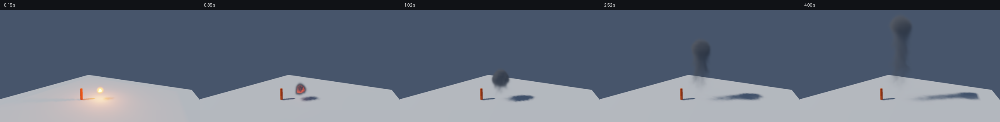
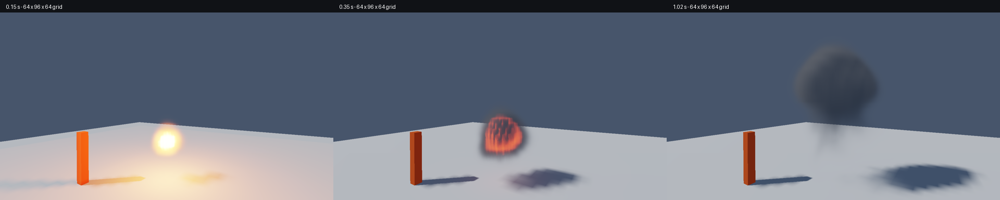
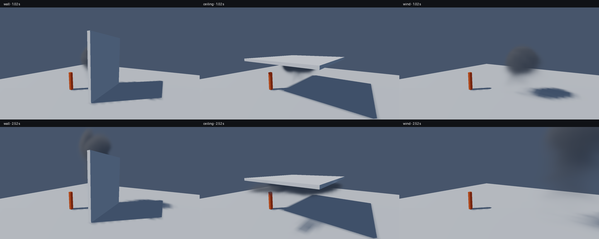
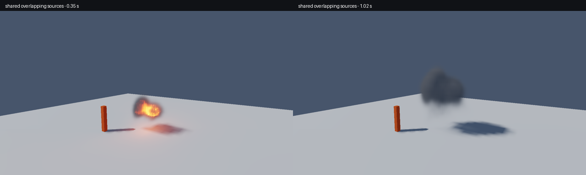

# Reactive smoke/fire capture record, 2026-11-03

The engine implementation is `cec2f70`; this native consumer is `6f856c9`.
Later evidence and engine-pin commits leave the captured runtime code unchanged.
All eleven runs returned success with unchanged before/after source identity,
Vulkan synchronization validation and identical executable/shader SHA-256 values.
The [machine-readable record](effects/captures.json) contains exact arguments,
source commits/tree digests, binary/media hashes, telemetry and final summaries.
Full native logs, per-frame CSVs, raw PPMs and manifests remain in ignored
`build/publication/verification/effects-accepted-*` directories.

## Actual output

The same history at 0.15, 0.35, 1.02, 2.52 and 4.00 seconds, with the wide camera
and a 48 x 72 x 48 grid. The source injects 0.18 kg of gaseous fuel and a separate
localized ignition pulse. Hot soot emits light, then cool soot continues moving.

[Four-second native capture](effects/fuel-to-smoke.mp4): 120 actual frames at
30 Hz, from every second requested 60 Hz simulation frame. Encoding uses no
interpolated or generated motion. This frequent-readback run is separate from
the sparse-capture performance rows below.

A closer 64 x 96 x 64 view at 0.15, 0.35 and 1.02 seconds. Finite-grid flame
structure and smooth smoke remain visible. These captures demonstrate a working
coupled feature; they do not establish cinematic photorealism or grid convergence.

The ceiling holds smoke beneath it and redirects it laterally; the wall redirects
the plume; crosswind changes its trajectory. Visible boxes match the simulation
obstacles, with conservative cell coverage. Default captures can leave the late
plume outside the view; `--view 4` supplies the wider lifecycle framing.

The paired scenario supplies two 0.099 kg sources, 0.12 seconds apart, into one
shared gas field. Their physical footprints overlap; they are not two independent
alpha-blended volumes. Additional runs cover zero gravity, opposite/high sun,
a dark camera-inside view and a closer higher-resolution view.

## Measured cost

NVIDIA RTX 3080 10 GiB, driver 617.42, Windows x64, Release, Vulkan SDK 1.4.304.0,
1280 x 720, vsync disabled. Values are mean GPU stage times from frame 30 onward.
All listed runs use a 12 m/s CFL velocity bound and report zero velocity clamps.
These are stage costs, not FPS measurements; opaque/shadow/UI/output work and
CPU/presentation waits are additional. The crosswind domain has twice the width.

| Scenario | Grid | Simulation ms | Lighting ms | Volume resolve ms | Tracked MiB |
| --- | --- | ---: | ---: | ---: | ---: |
| ceiling | 48 x 72 x 48 | 29.14 | 0.18 | 0.97 | 83.48 |
| hero | 64 x 96 x 64 | 70.14 | 1.20 | 2.04 | 120.79 |
| highsun | 48 x 72 x 48 | 24.47 | 0.39 | 0.76 | 83.48 |
| inside | 48 x 72 x 48 | 25.99 | 0.41 | 0.99 | 83.48 |
| merging | 48 x 72 x 48 | 25.27 | 0.27 | 0.91 | 83.48 |
| open | 48 x 72 x 48 | 25.21 | 0.28 | 0.57 | 83.48 |
| opposite | 48 x 72 x 48 | 24.47 | 0.41 | 0.72 | 83.48 |
| wall | 48 x 72 x 48 | 28.68 | 0.23 | 0.76 | 83.48 |
| wind | 96 x 72 x 48 | 47.86 | 0.47 | 0.77 | 110.71 |
| zero | 48 x 72 x 48 | 25.26 | 0.38 | 0.74 | 83.48 |

The dense simulation dominates cost. In the 48-wide open case, the recorded work
for each requested 1/60 second exceeds 16.7 ms; this setting cannot sustain that
simulation rate on this measurement. The interactive clock preserves elapsed
world time and displays simulation debt. Lower grid widths are available. The
64-wide capture prioritizes detail and is substantially slower. First-use
pipeline/warmup costs are excluded from these warm means; raw CSVs retain them.
A 6 m/s bound was explored but clipped the flow, so it was rejected as the default.

The open four-second snapshot contains 0.0847209 kg unburned fuel, 0.095279 kg
burned fuel and 0.00524035 kg soot. Cooling/flammability can quench the remaining
fuel; the model does not force all source mass into an animated fireball.

## Checks and limits

Seven focused engine/consumer checks passed, including standalone public headers,
legacy rendering, synchronization, resource lifetime, mass/enthalpy ledgers,
analytic optical images, flame propagation, wind/gravity and obstacle conservation.
A further HDR CPU/GPU skinning image-parity check passed after the suite. See the
engine [numerical record](https://github.com/traidy2222/TheOne/blob/main/docs/VOLUME_VALIDATION.md).
Launcher syntax and the capture helper were also checked.

This is a dense local low-Mach gaseous deflagration model. It does not resolve
shock waves, sealed-vessel thermodynamics, liquid fuel evaporation, arbitrary
moving cut-cell topology, spectral chemistry or full global illumination.
Projection is iteration-bounded; radiation, emissive lighting and indirect
scattering use documented approximations. Visible grid detail and high-resolution
cost remain production-quality limits. The engine [API/model document](https://github.com/traidy2222/TheOne/blob/main/docs/VOLUMES.md)
spells out these boundaries. The original research design includes future work
that is not represented as a completed capability here.

All imagery is generated by this repository's original procedural lab geometry
and the separate engine simulation. It contains no extracted commercial assets.
