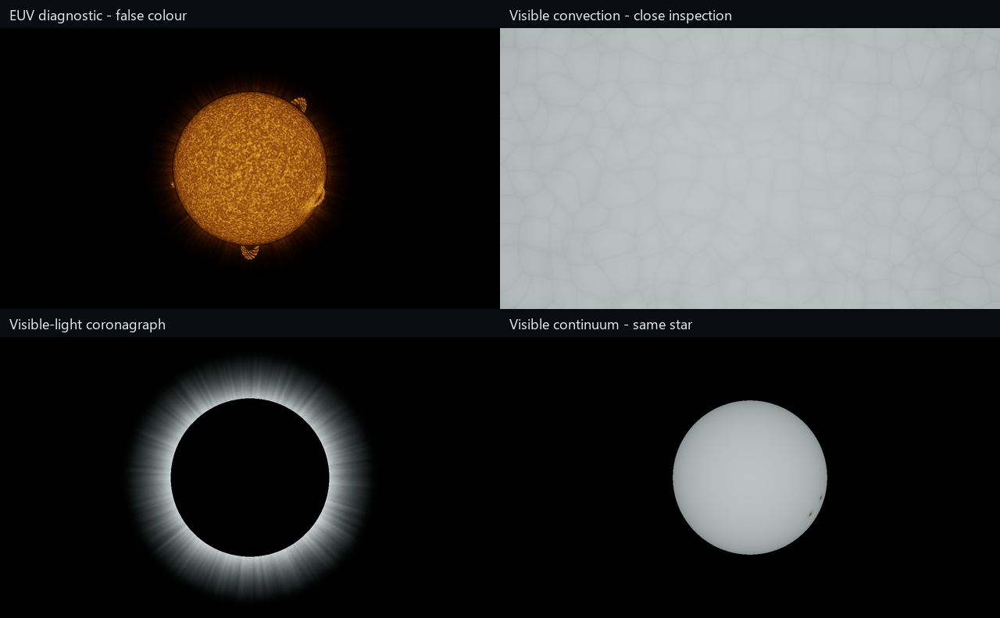

# Stellar activity validation, 2026-11-03

The subsequent [coronal MHD experiment](STELLAR_MHD_VALIDATION.md) replaces the
prescribed plasma in a resolved region and records the current physics runtime.

Engine `d28397a` and game consumer `a740846` add procedural activity to the separate
stellar sandbox. The [reference and model notes](https://github.com/traidy2222/TheOne/blob/main/docs/STELLAR_ACTIVITY_REFERENCES.md)
link the primary NSO, NASA and ESA observations and distinguish rendering
approximations from physical calculations. No reference photographs are bundled.



The default observer is a false-colour EUV diagnostic at 120x simulation time.
The opaque surface, raymarched atmosphere, sunspots and bundled plasma arches
share deterministic active regions. Whole-disk views filter unresolved granules;
the close-up resolves their representative 1,000 km scale. Visible continuum,
EUV and coronagraph use different observer displays while object illumination
retains the finite blackbody emitter. There is no directional fill light.

The [capture record](stellar-activity/captures.json) identifies the exact commits,
executable and shaders, commands, image hashes and profile measurements. Original
PPMs, logs and CSVs are local under ignored
`build/publication/verification/stellar-activity/`. The published PNGs are native
1280x720 captures; the comparison sheet resizes them and adds labels.

Focused CPU, GPU, public-module and game/engine separation checks passed. They
cover normalized limb darkening and Thomson scattering, region footpoint geometry,
input validation, unchanged bolometric solar flux, inverse-square lighting,
eclipses, observer-colour isolation, zero-power darkness, off-limb plasma and time
evolution. A translated inspection camera produces the identical image with a
star-centred origin, guarding against inverse-view-projection precision banding.
The existing GPU smoke-volume checks also passed after the shared uniform changes.

All eleven native scenarios and the visible control panel completed with Vulkan
synchronization validation and no validation errors. The existing unused vertex
attribute performance warning remains. Fixed-time captures at frames 12 and 140
are byte-identical. The panel and all four observer images were inspected.

Measured uncapped on an RTX 3080, driver 617.42, at 1280x720 with the whole-star
EUV preset, no validation and no UI:

| Ray budget | Median GPU frame | 95th percentile |
| --- | ---: | ---: |
| 32 | 3.48 ms | 3.62 ms |
| 64 (default) | 6.55 ms | 6.95 ms |
| 128 | 12.49 ms | 12.95 ms |
| 192 (reference) | 18.06 ms | 19.06 ms |

Each profile retained 119 samples after excluding twenty warm-up frames and the
capture frame. These are GPU frame timings for this preset, not a guaranteed
interactive frame rate. A star filling the viewport costs more. Capture readback
and file writing take much longer and are excluded from those measurements.

Against 192 steps, the 64-step image has mean absolute RGB error 0.55/255 over
nonblack reference pixels, with 95th percentile 2/255. Some narrow prominence
pixels differ by up to 154/255: the default is not fully converged, and fine
strands can show sampling patterns. Increase the ray budget for inspection.

This is an observation-informed procedural prototype, not an MHD simulation or
calibrated solar instrument. In particular, cool-plasma line emission, diagnostic
opacity and EUV response are illustrative; loop evolution does not solve magnetic
reconnection or energy conservation. Visible-light brightness remains much less
dramatic than the false-colour diagnostic. See the engine notes for the full limits.

To reproduce a fixed-time activity capture with a configured game build:

```powershell
$stellar = (Get-Content build/launch/stellar-Release.txt -Raw).Trim()
& $stellar --smoke-test --validate --clean --scenario 6 --time 0 `
  --ray-steps 64 --frames 12 --output build/verification/activity
```

Scenarios 6–10 are EUV, convection close-up, coronagraph, visible continuum and
evolved EUV at 900 simulated seconds. The earlier scenarios 0–5 retain activity
disabled for the original lighting regressions.
