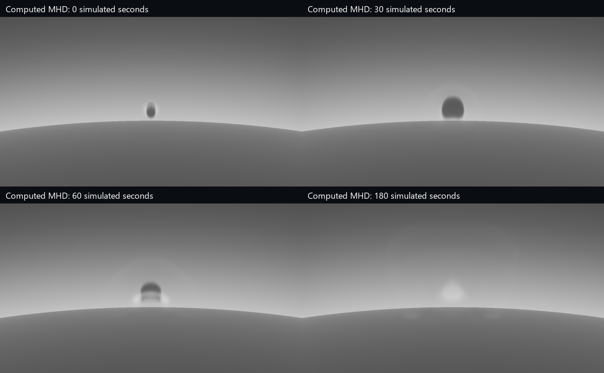
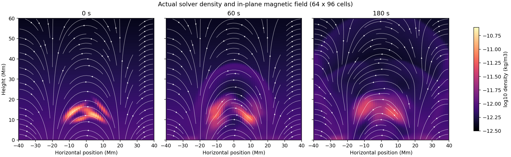

# Coronal MHD experiment, 2026-11-04

The game now consumes the engine's [resistive MHD module](https://github.com/traidy2222/TheOne/blob/main/docs/RESISTIVE_MHD.md).
The exact runtime commits, commands, executable/shader hashes, state hashes and
measurements are in [captures.json](stellar-mhd/captures.json). Engine and game
remain separate public repositories.



These are native 1280x720 Vulkan captures. Cool dense material absorbs the
synthetic coronal emission, so dark structures are part of this diagnostic.
The display is a broad monochrome temperature composite, not ordinary visible
sunlight or a calibrated solar instrument. The images remain soft at this grid
resolution; this is a physics prototype, not a finished photorealistic star.



This second figure is derived from the actual exported solver state. Colour is
density, and streamlines show the in-plane magnetic field. The out-of-plane guide
field is evolved but is not shown by these streamlines. No reference photos or
AI-generated images are used in either figure.

## Experiment and scope

The 64x96 Cartesian region spans 80x60 million metres. Normalisation is L0=20 Mm,
v0=200 km/s, rho0=1e-12 kg/m³, with ideal-gas gamma=5/3 and surface gravity
274 m/s² decreasing with altitude. The initial potential arcade includes small
harmonics, seven imposed pressure-balanced cold threads and a small pressure
perturbation. The threads are initial conditions, not condensations generated by
radiative cooling. The latter physics is not implemented.

**Stress field** injects guide-field energy, recorded exactly by the solver.
Subsequent motion follows compressible resistive MHD, pressure, magnetic tension,
magnetic pressure and gravity. There is no prescribed eruption trajectory.
The lower boundary is line-tied with slow out-of-plane shear, x is periodic and
the upper boundary is open. Effective resistivity is 4e9 m²/s, a resolution-scale
choice rather than microscopic solar resistivity.

At 180 simulated seconds, the stressed case has normalised kinetic energy
0.122275 versus 0.0131839 in the matched control: a factor of 9.27. Relative
face-flux divergence is 6.79e-15 after 1,273 steps. Density and pressure remain
positive without timestep rejections. This establishes a response to magnetic
work; it does not establish a predictive solar CME or reconnection rate.

The public solver also passes uniform equilibrium, circular Alfvén-wave
propagation/convergence, nonlinear Orszag–Tang conservation and positivity,
Ohmic heating, divergence and injected-work checks. Alfvén L1 error decreases
from 1.23247e-4 at 32 cells to 3.36175e-5 at 64 cells.

The renderer consumes density and temperature snapshots and suppresses the old
prescribed arches/spicules for this emitter. An ambient baseline and local
transfer correction remove the patch-boundary brightness artifact. A GPU
regression requires an unperturbed patch to produce an identical image after
relocation. Temperature-dependent emission, old stellar lighting regressions,
GPU smoke volumes, standalone headers/modules and engine/game separation pass.
All eleven original native scenarios, the four-time MHD sequence, the unforced
control and the panel complete with Vulkan synchronization validation and no
validation errors. The pre-existing unused vertex attribute warning remains.

## Runtime measurement and controls

Uncapped on an RTX 3080, driver 617.42, at 1280x720, without UI or validation:

| Case | Median frame | Frame p95 | Median GPU frame |
| --- | ---: | ---: | ---: |
| Frozen MHD state, 64 ray steps | 2.16 ms | 3.63 ms | 1.61 ms |
| Frozen MHD state, 128 ray steps | 2.70 ms | 4.71 ms | 2.21 ms |
| Evolving MHD, 64 steps, requested 6x | 9.09 ms | 11.48 ms | 1.63 ms |

The frozen profiles retain 119 samples and the evolving profile 219, excluding
twenty warm-up frames and the capture frame. Preroll, readback and file writes
are excluded. These are short, preset-specific measurements rather than a
guarantee for arbitrary scenes or long runs. Against 128 steps, the 64-step image
has mean absolute RGB difference 0.22/255 and maximum 1/255 in this view. That
does not prove spatial or physical convergence of the MHD region.

The default opens the magnetic region at t=30 s, requesting 6x time acceleration.
The CPU solver uses up to four workers when OpenMP is available and permits at
most four CFL-limited substeps per rendered frame. The displayed clock is the
actual evolved time. **Pause evolution**, **Replay**, **Stress field**,
**Magnetic region** and **Whole star** provide inspection controls. Physics output
is per metre of the invariant third dimension; the finite viewing depth is a
rendering approximation.

```powershell
$stellar = (Get-Content build/launch/stellar-Release.txt -Raw).Trim()
& $stellar --smoke-test --validate --clean --scenario 11 --time 180 `
  --frames 12 --output build/verification/mhd-180
```

Captures also write `mhd-state.csv` with SI density, pressure, velocities and all
magnetic components. `--evolve` advances physics during a bounded smoke run.
Raw captures, logs and CSVs remain under ignored
`build/publication/verification/stellar-mhd/`.

This remains 2.5D local MHD with synthetic radiation. Full 3D instabilities,
thermal conduction, radiative energy losses, ionisation and fine prominence
threads are unresolved or absent. Photospheric convection remains procedural.
