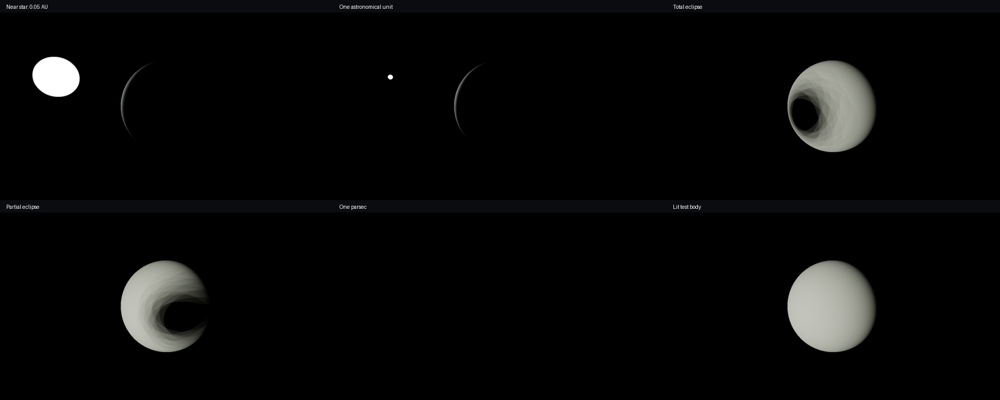

# Stellar sandbox validation, 2026-11-03

This records the original lighting baseline. The subsequent
[stellar activity validation](STELLAR_ACTIVITY_VALIDATION.md) covers the current
procedural surface, corona and observer modes.

The checked runtime is engine `d977643` and game consumer `5925242`. Subsequent
evidence and panel-layout changes leave the captured geometry and lighting unchanged. Both projects remain separate.

These are native Vulkan captures: near star at 0.05 AU, one AU, total eclipse,
partial eclipse, one parsec and the lit side of the test body. The display uses
automatic exposure by default; exposure is a camera control and the physical
flux remains independent of it. At one parsec the bounded exposure cannot make
the body visible. There is no ambient sky fill or directional sun in this mode.

The initial star uses a 695700000 m radius and 5772 K blackbody model. Recorded
unblocked flux is 544465 W/m² at 0.05 AU, 1361.16 W/m² at one AU, and
3.19934e-8 W/m² at one parsec. The one-AU result agrees with the approximately
1361 W/m² [NASA reference](https://earth.gsfc.nasa.gov/climate/projects/solar-irradiance/science).
The test body is an original airless sphere for inspection, not a simulation of
Earth or a prediction of surface conditions near a star.

Focused checks passed:

- CPU solar luminosity/irradiance, exact inverse-square ratio, large-coordinate
  translation, clear/blocked/partial visibility and stellar photosphere occlusion.
- GPU inverse-square surface response: decoded near/far ratio 3.98567 versus an
  ideal four, after 8-bit display conversion.
- GPU eclipse darkness with nonzero legacy lighting defaults, sampled penumbra,
  and apparent stellar size: 148 bright pixels shrinking to 44 at twice distance.
- Identical star image after rebasing the world origin to 1e18 m; off-axis and
  full astronomical observer/body arrangements remain visible. The full-scene
  arrangement is a regression for the combined emitter/body visibility traversal.
- Standalone public headers/module linkage, game/engine separation and the
  existing GPU volume checks after the shared HDR input changes.
- Six final sandbox scenarios completed with Vulkan synchronization validation,
  with no validation errors. An existing unused-vertex-attribute performance
  warning remains distinct from errors.

The [capture record](stellar/captures.json) contains exact native arguments,
commits, executable/shader hashes, GPU/driver, image hashes and final measurements.
Raw PPMs, native logs and CSVs remain local under ignored
`build/publication/verification/stellar-release/`. Capture readback/file writes
are slow and are not a measure of normal interactive frame rate.

The final visible star was checked directly in the actual sandbox capture;
passing the small reference fixture alone was insufficient to establish it.
All imagery uses original procedural geometry and engine rendering.

This is the first radiative-lighting sandbox. Sixteen finite-disk samples and
analytic spherical occluders produce visible penumbra sampling bands. RGB uses
three Planck bands rather than full spectral/colorimetric transport. There is no
stellar interior/corona, atmosphere/dust, indirect surface GI, arbitrary triangle
shadow tracing, orbital physics or light-travel delay. See the engine
[model and limits](https://github.com/traidy2222/TheOne/blob/main/docs/STELLAR_LIGHTING.md).
